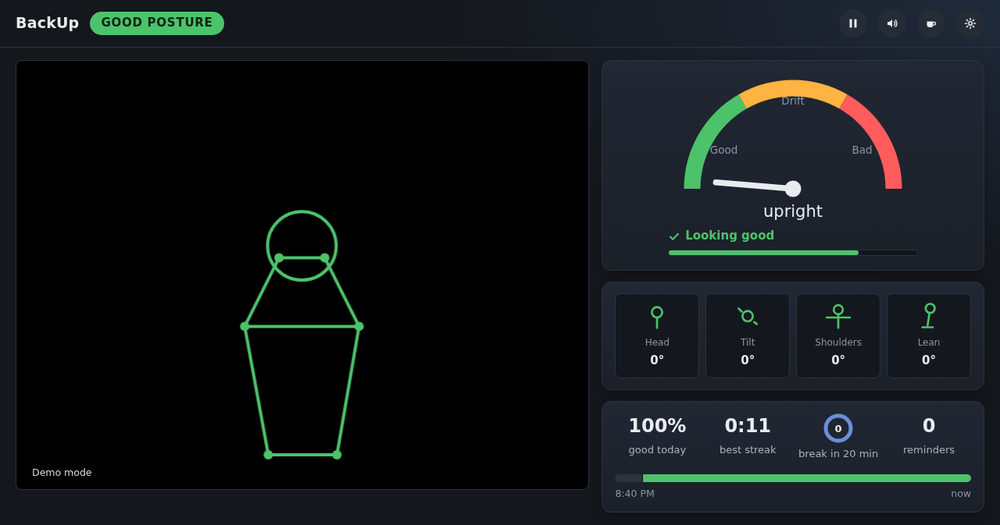
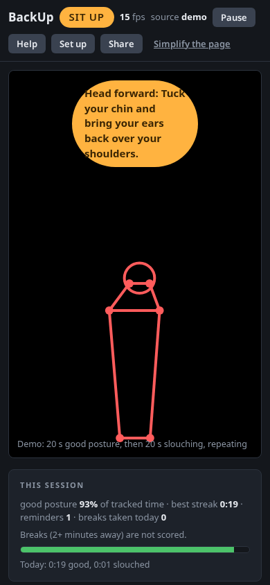

# BackUp

**BackUp — Posture to Die For.** (Please don't. That's the whole point.)

Somewhere between your third coffee and your fourth meeting, your head drifted
forward until your ears were hovering over the keyboard. BackUp noticed.
Leave a browser tab open with your webcam on, and it watches how you sit. Slouch,
and it chimes. Keep slouching, and it tells you out loud exactly what is wrong and
how to fix it. Everything runs on your computer; no video or landmark leaves it.

**Try it: <https://arii.github.io/backup/app/>** (press *Try the demo* if
you have no camera).





> **Safety.** BackUp is a wellness tool, not medical advice or a medical
> device. Do not hold a rigid posture. Stop and see a clinician if you have pain,
> numbness or dizziness. Webcam estimates are approximate. Provided as-is under the
> MIT License. See [`.kiro/specs/safety-and-disclaimers`](.kiro/specs/safety-and-disclaimers/design.md).

**Contents:** [What it notices](#what-it-notices) ·
[Getting started](#getting-started-first-visit) ·
[Requirements and limits](#requirements-and-known-limitations) ·
[Features](#features) ·
[Setup tips](#setup-tips-and-how-reminders-work) ·
[Privacy and safety](#privacy-safety-and-medical-disclaimer) ·
[Progress](#progress-and-the-leaderboard-what-is-built-what-is-planned) ·
[Wellness tools](#wellness-tools-what-is-built-what-is-planned) ·
[Research](#feedback-design-and-the-research-behind-it) ·
[The monster](#the-monster-kiroween-2026-frankenstein) ·
[Built with Kiro](#built-with-kiro) ·
[Tuning](#tuning) · [Development](#development) · [Layout](#layout)

## What it notices

| Habit | Folk name | What BackUp tells you |
|---|---|---|
| Head forward | Tech neck: your ears have wandered ahead of your shoulders | "Tuck your chin and bring your ears back over your shoulders." |
| Head tilted | The puzzled dog | "Straighten your neck so your ears are level." |
| Shoulder dropped | Uneven shoulders | "Level your shoulders." |
| Leaning sideways | The Leaning Tower of Pisa | "Sit up straight with your weight even on both hips." |

The advice never names a side, so a mirrored webcam image cannot make it wrong. Sit up
and it plays a reward chime, because positive reinforcement works on spines too.

BackUp is a reminder, not a doctor. If something hurts, see a human
professional, not a webcam.

## Getting started (first visit)

1. **Open the app.** One short welcome explains privacy and safety. The full
   safety notice is available without leaving the page.
2. **Start the webcam** (or try the demo). Keep your head and shoulders in frame.
3. **Get comfortable.** Optionally save your comfortable posture with a single
   three-second recording. There is no required slouch recording or settings tour.
4. **Keep working.** The main screen shows only the live view, a posture gauge
   and one session line. When you slouch, the cue appears once, as a banner on
   the video.
5. **Settings grow as you use it.** *Settings* opens a short list in a side panel:
   *Chime*, *Say what to fix*, *Save my posture again*, *Take a break now* and *Help*.
   After 2 minutes *Break reminders* joins, after 5 minutes *Shoulders & breathing*,
   and on your second day *My week*. Each new row is offered once as a small card.
   *Help* has *Learn the cues* and *Not working?* for camera troubleshooting.

Design and requirements: [`.kiro/specs/onboarding-and-setup`](.kiro/specs/onboarding-and-setup/requirements.md).

## Requirements and known limitations

**Requirements:** a webcam (or use the demo), a recent Chrome, Edge or Firefox, and
**hardware acceleration / WebGL turned on** for best accuracy. If WebGL is off, the
site says so up front and the webcam switches to a simpler fallback (TF.js MoveNet on
the WASM/CPU backend). It is less accurate and slower, and an on-screen notice says
so. *Try the demo* works either way. Safari and phones are not tested or supported
yet. Use a laptop or desktop; iOS Safari can stop the camera when the tab is in the
background.

To turn hardware acceleration on in Chrome or Edge, open `chrome://settings/system`,
enable *Use graphics acceleration when available*, relaunch, and check
`chrome://gpu`. On Linux/Wayland you may also need `--ozone-platform=x11`. In
Firefox, set `webgl.disabled` to `false` in `about:config`.

**Known limitations:**

- Glasses: glare or reflections can confuse the pose model.
- Low light: tracking gets jumpy. Put light in front of you.
- Side-angle or off-center cameras: readings assume the camera faces you.
- Partial framing: head and both shoulders need to be in view.
- One person only.
- A webcam gives approximate estimates. Nothing here is clinically validated.

## Features

- **Tells you what to fix.** Reminders name the problem and the fix, on screen and
  out loud: "Head forward: tuck your chin and bring your ears back over your
  shoulders", "Shoulders uneven: level your shoulders", "Head tilted: straighten your neck", "Leaning sideways: sit up with your
  weight even". The advice is sideless, so a mirrored camera image never changes it.
  The needle shows no score number, only a one-word label.
- **Recorded voice.** Prompts use pre-recorded Kokoro voices, with the browser's
  speech synthesis as a fallback.
- **Everything in the tab.** MediaPipe Pose Landmarker and the scoring, reminder
  state machine, posture needle and calibration (`docs/app/posture-core.js`). The
  model and its WASM runtime are self-hosted in `docs/app/vendor/`, so no third-party
  server is contacted.
- **Works in the background.** Tracking continues at about 5 fps when the tab is
  hidden. Chimes play through Web Audio and the prompt through recorded clips or the
  browser's speech synthesis.
- **Remembers you.** Calibration, settings, the camera you last used and daily
  good/slouch totals persist in `localStorage`.
- **Share.** The sponsor card's *Share instead* opens plain links (no third-party
  scripts) and a *Share your score* PNG card drawn in the tab from this session's
  good-posture percentage and best streak. It never contains a camera frame.
- **Breath check and relax reminder, hold-to-fill bars, pause, and *Report a bug***
  (a public GitHub issue, so keep private details out).

GitHub Pages serves `docs/` from `main`, so the live app updates on every merge.

## Setup tips and how reminders work

### Webcam placement

Put the laptop or webcam roughly at eye height, 0.6-1.2 m away, facing you, with
your head and both shoulders in frame (hips help but are optional). The framing
gate expects your shoulders to span 12-65% of the frame width; outside that the
badge reads **PERSON TOO FAR** or **PERSON TOO CLOSE**.

### Slouch, chime, voice, recovery

1. Sit with good posture for a few seconds. The badge reads **GOOD** and stays quiet.
2. Slouch and hold it. After about 2 s of confirmed bad posture the **chime fires
   once** and the badge flips to **BAD**.
3. Keep slouching. About 10 s after the chime the **spoken prompt** fires, and repeats
   at most every 30 s while the posture stays bad.
4. Sit up straight. After about 3 s of good posture the state returns to **GOOD**,
   the recovery chime plays once, and everything goes quiet.

Leave the desk and after about 2 s with no pose the state becomes **NO PERSON**
(silent). Reminders never fire on bad data: if landmark confidence drops or you sit
out of frame range, the badge reads **UNRELIABLE** and the app stays silent. A
garbled frame (NaN/inf landmarks) is ignored: the state holds and no streak or timer
resets.

### Calibrate to your desk

The posture needle reads -1 when upright and +1 at your bad-posture thresholds. To
fit it to your chair and camera: sit the way you want to sit, press **Record good
posture** and hold still for 3 s, then slouch the way you usually do and press
**Record slouch posture**. Your good posture now reads -1 and your slouch +1. The
good recording also anchors the slow deviation baseline, so it measures drift from
*your* upright posture and keeps that reference when you leave the desk. Reminders
still use the thresholds. **Reset calibration** returns to the defaults. Calibration
is kept in this browser's `localStorage`.

Without a recording, the baseline learns from the first frames it sees. If you sit
down slouched, it learns the slouch as normal and sitting up straight can read as a
deviation. Record good posture once per session to avoid that.

## Privacy, safety and medical disclaimer

This wording is a draft. It is not legal advice, and the owner should have a lawyer
review it before any wider launch.

- BackUp is a wellness tool. It is not medical advice and not a medical device,
  and it does not diagnose, treat or prevent any condition.
- Do not hold a rigid posture. Relax your shoulders and change position often.
  Reminders are not a substitute for regular movement breaks. The evidence that "perfect"
  sitting posture prevents back pain is weak (see the research document).
- Stop and see a qualified clinician if you feel pain, numbness, tingling or dizziness,
  or if pain persists.
- If you have a spine, nerve, neuromuscular or other medical condition, are pregnant,
  or are recovering from an injury, check with a professional first.
- Webcam estimates are approximate. Lighting, camera angle, clothing and body shape
  change the result. "Good" means close to your own calibrated baseline.
- Video and landmarks are processed on your machine and not uploaded. The browser
  version serves its pose model and scripts from the same site.
- Provided as-is, without warranty, under the [MIT License](LICENSE).

How it works in the app: the first run requires an acknowledgement stored as
`ackVersion` in `localStorage`. Bumping `ACK_VERSION` in `docs/app/onboarding.js` asks
everyone again. The same notice appears in the app footer, the landing page and under the *Relax, don't brace* panel. Full spec:
[`.kiro/specs/safety-and-disclaimers`](.kiro/specs/safety-and-disclaimers/requirements.md).

### Offline copy and browser caching (no longer offered)

Earlier versions had a **Make available offline** button. Since the Settings list was
cut to eight rows (#96) it is not offered, and nothing installs a service worker.
A copy made before stays until **Delete my data** (in *My week*) or clearing this
site's data. Like any website, your browser
may keep the pose model in its normal HTTP cache after you start the app. This is not the Offline mode and holds no video.
The landing page may start fetching the model when you point at, focus or press its link to the app
(never on load, and not on Save-Data or slow connections). Video is never stored, with or
without an offline copy; the cache holds only the app's own files.

For contributors: `docs/app/precache.json` lists every file the worker caches, and
`docs/app/sw.js` carries its version. After changing anything under `docs/app/`,
run `node scripts/gen-precache.mjs` (CI runs it with `--check`, and the voice-clips
workflow runs it after rendering clips). Offline needs HTTPS or localhost.

## Progress and the leaderboard (what is built, what is planned)

| Item | Status |
|---|---|
| *Your progress* panel: last 7 days of good % and good minutes, total minutes, no broken-streak messaging | Built (browser) |
| Silent-test trend versus coached score, and the light-coaching suggestion | Built (browser) |
| Export progress as JSON, *Delete my data* (clears `posture-guard:v1`) | Built (browser) |
| Social leaderboard | **Spec only.** Opt-in, pseudonymous, aggregate scores only, no video or landmarks leave the machine, no account needed for the core app. It must reward consistency, breaks and relaxation, not rigid "good %", and count only tracked time |

The default stays a personal review. Backend options and anti-gaming rules are in
[`.kiro/specs/progress-review`](.kiro/specs/progress-review/requirements.md).

## Wellness tools (what is built, what is planned)

Opt-in, no medical claims, and every prompt goes through one scheduler (at most one
non-posture prompt every 10 minutes). Items marked spec only are designed, not built. See [`.kiro/specs/wellness-tools`](.kiro/specs/wellness-tools/requirements.md).

| Tool | Status |
|---|---|
| Breath check and bracing monitor (*Relax, don't brace*) | Built |
| Guided slow-breathing exercise (*Breathe with me*) | Built. Needs your opt-in (a dated consent record in this browser) |
| Face and jaw check, a timed reminder every 30 or 45 minutes, off until you choose it (a webcam cannot see jaw tension) | Built. The blendshape version needs the Face Landmarker and an extra model download: spec only |
| Neck and shoulder micro-stretch prompts | Built (optional reminder and the *Take a break* menu) |
| 20-20-20 eye breaks | Built |
| Stand and move microbreak timer | Built |

**Red line:** breathing, tension and posture data are never sent to a server (no accounts,
sync, analytics or leaderboards) without redoing the legal review in
[`docs/legal-checklist.md`](docs/legal-checklist.md).

## Feedback design and the research behind it

The feedback rules come from motor-learning and behavior-change research, summarized
in [`docs/research/feedback-and-habit-formation.md`](docs/research/feedback-and-habit-formation.md).
In short:

- Cues are immediate, specific and about the task ("tuck your chin"), never about the
  person. No shaming wording, no punishing sounds, no streak-loss messages.
- Praise is opt-in and earned. Milestone praise (banner and chime, spoken only if
  spoken praise is on) fires once at 5, 15, 30 and 60 continuous good minutes.
- Frequent feedback can help now and hurt retention. The code keeps a **Light** coaching
  level (banner and chime first, voice only after a second reminder episode, praise only
  at milestones) and a silent *Test me* retention test, but since #96 neither is a
  setting: Standard coaching is the fixed default and the test has no entry point.
- A per-hour reminder cap (30) limits alarm fatigue. Nothing is spoken during pause or the silent test. During the eye break and the guided stretch, move, water and jaw breaks, posture coaching is suspended (no cues, reminders or praise, and that time is not counted as slouching), and it stays off for 10 seconds after the break ends.

How sure are we? Sources were checked in two tiers. **Verified** means the abstract
or page text was read and supports the claim. **Metadata only** means the citation
exists (Crossref) but the abstract was not readable, so the detail is not relied on
(for example, the often-quoted "a third of feedback interventions decreased
performance" was not re-checked and is not stated as fact). Most evidence is from lab
motor learning and workplace studies, not this app. **Nothing here is clinically
validated.** Spec: [`.kiro/specs/feedback-design`](.kiro/specs/feedback-design/requirements.md).

## The monster (Kiroween 2026: Frankenstein)

BackUp is stitched together from parts that were never meant to share a
body. Unlike its namesake, it sits up straight.

| Body part | Donor | Job |
|---|---|---|
| **Eyes** | Google MediaPipe Pose, compiled to WebAssembly | 33 body landmarks per frame from an ordinary webcam |
| **Brain** | JavaScript: scoring, reminder state machine, posture needle, calibration (`docs/app/posture-core.js`) | Decides when you are slouching and what to say about it, inside your browser tab |
| **Spinal cord** | A golden timeline: a scripted session recorded once (from the Python original, since removed), replayed by Node | Keeps every decision stable, numbers within 1e-9 |
| **Voice** | Web Audio, recorded Kokoro clips and speech synthesis | The chime, then "Head forward. Tuck your chin..." |
| **Heartbeat** | A Web Worker timer | Keeps tracking at ~5 fps after the browser throttles a background tab |
| **Memory** | `localStorage` | Your calibration, settings, custom sounds, daily totals, usage counts for the sponsor prompt and your dated consent record |
| **Packed lunch** | An opt-in service worker (`docs/app/sw.js`) and Cache Storage | The app's own files, so it runs with Wi-Fi off (see Offline mode) |
| **Immune system** | `node:test` | Seven correctness properties plus unit tests |
| **Lab test subject** | Playwright, Chromium's fake camera, and a node script that draws a cartoon figure into a video feed | Checks that the deployed site finds a person (the figure is drawn in `scripts/make-fake-camera.mjs`, no photo of anyone) |
| **Lightning** | Kiro: specs, steering and hooks | It's alive. |

Why these parts don't normally fit, and the stitches that hold them:

- **The brain started life in Python,** which can't run in a browser tab. It was
  ported to JavaScript and the Python original was deleted in Nov 2026. A golden
  timeline recorded from it still pins every state, reminder and word of advice over a
  scripted session.
- **Browsers throttle background tabs to save battery,** which is exactly when a
  posture coach needs to keep working. A Web Worker keeps the pulse going, and the
  state machine is frame-rate independent, so reminders still land on time at 5 fps in
  the background.
- **A webcam has no depth sensor.** The prototype needed an Intel RealSense depth
  camera; that limb was amputated. Distance now comes from how wide your shoulders
  are in the frame.
- **MediaPipe labels sides from your point of view; webcams often mirror the image.**
  The advice works out which side is yours from the shoulder line, and a property
  test checks that mirroring the picture never changes what it tells you.

## Built with Kiro

The browser app and its test suite were built with
[Kiro](https://kiro.dev), spec-first; [`KIROWEEN.md`](KIROWEEN.md) has the build
history. The `.kiro/` directory is committed so judges can read it:

- `.kiro/specs/backup/requirements.md`: EARS acceptance criteria for the
  camera modes, frame hardening, smoothing, needle, calibration, sounds, config and
  the browser version.
- `.kiro/specs/backup/design.md`: module design, the smoothing-window fix,
  and the seven correctness properties the property tests check.
- `.kiro/specs/backup/tasks.md`: the implementation plan, checked off.
- `.kiro/steering/architecture.md`: standing rules for the agent (tuning defaults in
  one place, injected timestamps, frame-rate-independent EMAs, the precache step,
  headers on new files, safety and claims, feedback design).
- Follow-on specs (requirements, design and tasks each; built items are checked,
  the rest are labelled spec only):
  - `.kiro/specs/onboarding-and-setup/`: first-run walkthrough, setup check, practice.
  - `.kiro/specs/progress-review/`: personal progress (built), social leaderboard (spec only).
  - `.kiro/specs/wellness-tools/`: breath check (built), the other tools (spec only).
  - `.kiro/specs/safety-and-disclaimers/`: disclaimer wording, acknowledgement, claims.
  - `.kiro/specs/feedback-design/`: research-driven feedback rules and coaching level.
- `.kiro/hooks/node-tests-on-change.json`: runs the node tests whenever a file under
  `docs/app/` or `tests/js/` is saved.

The specs under `.kiro/specs/` were written while a Python desktop app also existed;
parts that describe it are marked as history.

The property tests found two real problems: the original smoothing window never
confirmed at low frame rates or with jittered webcam timestamps (fixed), and a
session that starts slouched teaches the deviation baseline the wrong neutral
(mitigated by the good-posture anchor, documented above).

## Kiroween 2026

BackUp is a [Kiroween 2026](https://kiroween.devpost.com/) entry in the
**Frankenstein** category: seemingly incompatible technologies (a brain ported from Python to JavaScript,
WebAssembly eyes, two voice boxes, a Web Worker heartbeat)
stitched into one app. See [The monster](#the-monster-kiroween-2026-frankenstein)
above. [`KIROWEEN.md`](KIROWEEN.md) has the submission write-up, the build history
and what Kiro did. Licensed under the [MIT License](LICENSE).

Fastest path: open <https://arii.github.io/backup/app/> and press
*Try the demo*, or *Start with webcam*.

To run and test it locally, see [Development](#development).

Submission deadline: **Dec 4, 2026, 2:00 PM PT**.

## Tuning

The knobs are the `DEFAULTS` object at the top of `docs/app/posture-core.js`. All
durations are seconds and all angles degrees.

| Symptom | Knob |
|---|---|
| Chimes too eagerly / not eagerly enough | `scoring.*_deg` thresholds (bad when abs(angle) passes them) |
| Flickers between GOOD and BAD | `scoring.hysteresis_margin_deg` (higher = stickier) |
| Nudges before you even settle into the chair | `state.bad_sustain_s` (chime delay), `state.good_confirm_s` |
| Voice prompts too aggressive | `state.voice_delay_s` (after chime), `state.voice_repeat_cooldown_s` |
| Positive chime (rewards sustained good posture) | `feedback.positive_chime.*` |
| Person scored too far / too close | `scoring.shoulder_width_min` / `scoring.shoulder_width_max` |
| Needle too jumpy / too sluggish | `needle.tau_s` (EMA time constant) |
| Calibration fails ("N scored frames") | sit fully in frame; `calibration.window_s`, `calibration.min_samples` |
| Sound on recovery | `feedback.recovery_chime.enabled` |

Voice timing and the feedback mode can also be changed live in the app's settings.

## Development

Needs Node 22. No build step and no dependencies for the app or its tests. The root
`package.json` only holds dev tooling: [Biome](https://biomejs.dev) (lint and format) and
[fallow](https://github.com/fallow-rs/fallow) (dead code). Run `npm install` once to use them.

```bash
node --test "tests/js/*.test.mjs"   # unit, property and golden-timeline tests
node scripts/gen-precache.mjs       # after ANY change under docs/app/ (CI runs it with --check)
python3 -m http.server 8000 --directory docs   # serve the app locally (any static server works)
npm run lint          # biome lint
npm run format        # biome format --write (format:check only verifies)
npm run deadcode      # fallow dead-code (unused files, exports, dependencies)
npm run check         # all of the above plus tests and the precache check
```

`tests/js/fixtures/golden-timeline.json` is a frozen recording of a scripted session
(slouch to chime and voice, recovery, tilt, neutral wobble, hidden hips, NaN glitches,
leaving, sitting too far, calibration, mirrored framing): the config it ran with, and
the expected state, reminders, reasons, cue and needle for every frame.
`tests/js/posture-core.test.mjs` replays it through `posture-core.js` and requires
identical states, reminders and reasons, and metrics and needle within 1e-9. If you
change behavior on purpose, update the expected values in the fixture to match and say
why in the commit.

CI runs lint, format and dead-code checks, the node tests, the precache check, the vendored-file checksums, a local
Playwright e2e and ShellCheck on every push to every branch. After each GitHub Pages
deploy, the `live-site` workflow opens the deployed app in Chromium and runs demo mode
and webcam mode (with a fake camera playing a drawn cartoon figure).

Browser end-to-end check (needs a local server and Playwright):

```bash
npm install --no-save playwright@1 && npx playwright install chromium
python3 -m http.server 8000 --directory docs &
node tests/e2e/live-site.mjs http://localhost:8000/ "" ./e2e-out
```

The third argument is a fake-camera `.y4m` file; pass `""` to skip the webcam parts.
`tests/e2e/live-site.mjs` and `video/scripts/capture.mjs` pre-seed `localStorage`
with onboarding version 1 and ack version 1 so they can reach the Start buttons. If you
bump `ONBOARDING_VERSION` or `ACK_VERSION` in `docs/app/onboarding.js`, update those
hard-coded values too.

The seeded property tests in `tests/js/posture-core.test.mjs` check the correctness
properties in `.kiro/specs/backup/design.md`:

| Property | Checked over random input |
|---|---|
| P1 bounded needle | any landmarks incl. NaN/inf, any visibility, any calibration: finite, in [-1, 1], never throws |
| P2 scale invariance | scaling every landmark by k in [1e-3, 1e3] leaves all angles within 1e-5 |
| P3 anti-chatter | neutral-band noise and bad runs shorter than `bad_sustain_s` never remind, at 2-50 fps |
| P4 idempotent reminders | one chime per bad episode, voice delay and cooldown respected |
| P5 glitch transparency | inserting NaN frames anywhere changes nothing on the other frames |
| P6 time safety | `update()` never throws for non-decreasing time |
| P7 cue mirror invariance | mirroring the image never changes the cue; cues only name metrics past their band |

## Layout

```
docs/                  # GitHub Pages: landing page + the browser app (docs/app/)
docs/app/              # app.js (UI, state), posture-core.js (scoring, state machine, needle,
                       #   calibration, cues), one module per feature (breaks, breathing, prompts,
                       #   consent, offline, share, sponsor, relax, onboarding, progress, feedback)
docs/app/vendor/       # self-hosted MediaPipe runtime and pose model
docs/research/         # feedback and habit-formation research notes
biome.json, .fallowrc.json, package.json   # dev tooling config (lint, format, dead code)
scripts/               # gen-precache.mjs (offline file list), render-voice.mjs (Kokoro clips)
tests/js/              # node:test unit, property and golden-timeline tests
tests/e2e/             # Playwright check of the live site (see Development)
video/                 # Remotion demo video, rendered in CI from footage of the live app
.kiro/                 # Kiro specs, steering and hooks (see "Built with Kiro")
```

## Audit

[`docs/audit-2026-11.md`](docs/audit-2026-11.md) lists every request and open issue
with its status, the evidence, and what was overstated and corrected.

## Support and license

BackUp is free and built by one person. If it is useful to you, you can
[sponsor on GitHub](https://github.com/sponsors/arii). The app asks at most three
times, only after regular use (counted in your own browser, never sent anywhere),
and *Don't ask again* is permanent.

[](https://github.com/sponsors/arii)

Released under the [MIT License](LICENSE). Third-party credits:
[`THIRD_PARTY_NOTICES.md`](THIRD_PARTY_NOTICES.md). Not legal advice, but the
engineering side of the privacy and legal review is tracked in
[`docs/legal-checklist.md`](docs/legal-checklist.md).

Docs last verified: 2026-11-20.
